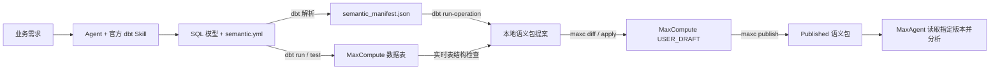

# 用 Agent 和 dbt 发布 MaxCompute 语义包

把“支付收入怎么算、按哪个时间统计、订单如何关联客户”保存在一个可审阅、可发布、可复用的语义包中，让后续的 Agent 分析有明确的业务依据。本教程从一段业务需求出发，使用 dbt 官方 Agent Skill 生成语义配置，再通过 dbt-maxcompute 和 maxc 将定义保存到 MaxCompute，并回读验证。

面向已经使用 MaxCompute、希望让 Agent 理解业务数据的开发者。你可以先阅读示例的数据和预期结果，理解完整链路，再运行仓库中的[配套项目](../examples/agent-semantic-package)。本文对应试用版 `dbt-maxcompute 1.12.1b1`、`maxc-cli 0.9.5b1` 和 `dbt Core 1.12.6`。

## 为什么值得使用语义包

同一句“收入”，可能指全部订单金额、支付成功金额，或扣除退款后的净收入。把这些规则只放在一次聊天里，换一个 Agent 会话时就需要重新解释。语义包可以集中保存指标公式、过滤条件、时间约定、表与字段说明，以及实体关联关系，供具备语义包读取能力的 MaxAgent 使用。

在这套流程中，业务人员给出口径，Agent 帮助编写配置，dbt 管理模型与测试，开发者审阅差异后发布一个确定的版本。团队可以把 YAML 和 SQL 放入 Git，在变更“哪些订单算收入”时一起审阅代码与语义差异，让数据加工和业务定义保持一致。语义包提供可复用的依据；实际分析仍需核对 Agent 读取的版本、生成的 SQL 和查询结果。

## 先看懂四种产物



| 产物 | 由谁生成、保存在何处 | 用途 |
|---|---|---|
| SQL 与 `models/semantic.yml` | Agent 辅助编写，用户审阅，保存在 dbt 项目/Git 中 | 定义数据加工和业务口径 |
| 订单、客户、日历表 | `dbt run` 在 MaxCompute 中创建 | 保存实际数据 |
| `target/semantic_manifest.json` 与提案 JSON | dbt 解析和导出宏生成，保存在本地 | 将已声明的语义转换为可审阅的发布内容 |
| Draft / Published 语义包 | maxc 调用 MaxCompute 语义包接口保存 | 持久化并发布表引用、指标、关联和说明 |

**保存语义包不会复制订单数据，也不会把 JSON 当作一张业务表写入。** 包中引用的是已存在的 MaxCompute 表。`apply` 写入可编辑草稿，`publish` 生成可供消费的发布版本；单独执行导出宏只会得到本地文件。

## 1. 安装并准备独立示例项目

需要 Python 3.12、Git，以及能运行本地命令的 Agent 客户端。安装官方 Skill 的命令还需要 Node.js/npx。MaxCompute 账号需能在目标项目/schema 中建表、查询这些表，并创建、修改和发布测试语义包；请先确认当前账号和地域可访问语义包服务。

在新目录创建虚拟环境，然后一行安装已经验证的版本组合（以下使用 macOS/Linux shell）：

```bash
python3.12 -m venv .venv
source .venv/bin/activate
python -m pip install 'dbt-core==1.12.6' 'dbt-maxcompute[semantic]==1.12.1b1' 'maxc-cli==0.9.5b1'
```

固定预发行版本号后无需 `--pre`。首次安装除了访问 PyPI，还会从 GitHub Release 下载 dbt 上游解析器；受限网络需允许 `github.com` 和 `release-assets.githubusercontent.com`，下载过程中可能长时间显示正在准备元数据。

获取示例并进入项目目录：

```bash
git clone https://github.com/aliyun/dbt-maxcompute.git
cd dbt-maxcompute/examples/agent-semantic-package
cp profiles.yml.example profiles.yml
export DBT_PROFILES_DIR="$PWD"
export SEMANTIC_DEMO_PREFIX="agent_sales_$(date +%Y%m%d_%H%M%S)"
export PACKAGE_NAME="$SEMANTIC_DEMO_PREFIX"
```

后续命令均在此目录、同一虚拟环境和 shell 中执行。前缀同时区分测试表和测试包；重新打开 shell 时请恢复原来的前缀，避免指向另一组对象。

> **重要**：示例采用 `materialized: table`，重跑 `dbt run` 会重建同名示例表。请使用独立前缀，勿与生产表重名。示例表生命周期为 7 天；表到期后，语义包中的引用不会自动变成可查询数据。

### 配置 dbt 与 maxc 连接

由你的凭证管理工具向当前进程注入 `ALIBABA_CLOUD_ACCESS_KEY_ID` 和 `ALIBABA_CLOUD_ACCESS_KEY_SECRET`，不要把密钥写入项目或 Agent 提示词。示例使用 AccessKey 认证；其他认证方式参见[认证配置](authentication.md)。设置非敏感连接参数：

```bash
export MAXCOMPUTE_PROJECT='<your_project>'
export MAXCOMPUTE_SCHEMA='default'
export MAXCOMPUTE_ENDPOINT='<your_https_maxcompute_endpoint>'
export UA="AlibabaCloud-Agent-Skills/alibabacloud-maxcompute-cli/$(python -c 'import uuid; print(uuid.uuid4().hex)')"
```

将占位值替换成自己的项目和对应地域的 HTTPS API endpoint。配套 `profiles.yml.example` 从这些环境变量读取 dbt 连接并设置 UTC。`maxc.json` 只包含空认证配置和 `default_schema: default`，maxc 从环境读取凭证；本文每个远端 maxc 命令都显式使用这个文件，避免误用已有连接。如果使用其他 schema，同时修改 `MAXCOMPUTE_SCHEMA` 和 `maxc.json` 的 `default_schema`。

```bash
dbt debug
maxc --config maxc.json agent context --json
maxc --config maxc.json agent manifest --json
maxc --config maxc.json agent doctor --online --user-agent "$UA" --json
maxc --config maxc.json auth whoami --user-agent "$UA" --json
```

确认 dbt 连接成功、doctor 的 `data.ready` 为 `true`，且两个工具连接同一 project/schema。`whoami` 的 `data.identity.semantic_namespace` 是后续命令默认使用的语义包命名空间。当前版本根据可信账号信息解析 namespace；RAM 身份无法明确解析主账号时，应核实主账号 ID 后显式传入 `--namespace`，不要用 RAM 用户 ID 或项目 tenant ID 猜测。

## 2. 让 Agent 从业务需求生成配置

### 安装官方 Skill

按照 [dbt-labs 官方安装说明](https://github.com/dbt-labs/dbt-agent-skills#installation)，在项目目录安装语义层 Skill，并在交互界面选择你的 Agent 客户端：

```bash
npx skills add dbt-labs/dbt-agent-skills --skill building-dbt-semantic-layer
```

重新打开或刷新 Agent 会话，确认它能发现 `building-dbt-semantic-layer`。Skill 是教 Agent 如何编写 dbt 语义层的说明文件，通常按任务自动加载。它可以直接用于这里的 YAML 编写；MaxCompute 导出范围和发布步骤由本教程补充，无需修改官方 Skill。官方 Skill 也支持更复杂的 dbt 指标，但当前导出器只支持后文明确列出的子集。

### 给 Agent 的完整任务

配套项目已提供一份可对照的完成版本。首次学习时，让 Agent 阅读模型并解释、核对配置；要体验从零生成，可先将 `models/semantic.yml` 移到项目外备份，再发送下面的需求。不要在 `models/` 下保留第二份同样的 YAML，以免重复定义。

```text
请使用 building-dbt-semantic-layer Skill，为当前 MaxCompute dbt 项目编写
models/semantic.yml。先读取 dbt_project.yml、models/orders.sql 和
models/customers.sql，再检查实际表结构或列出需要核实的假设。

业务要求：
- orders 每行是一笔订单，order_id 唯一且非空。
- 只统计 status='paid'；cancelled 和 refunded 均不计入。
- paid_revenue：amount 空值按 0 处理后求和。
- paid_orders：支付订单数，包括 amount 为空的订单。
- paid_aov：paid_revenue / paid_orders；分母为 0 时返回 NULL。
- 业务时间为 ordered_at，数据按 UTC 表示，按 UTC 自然日分组。
- customers 每行一个客户，customer_id 唯一且非空，region 是当前地域。
- orders.customer_id 关联 customers.customer_id，使用 LEFT 语义；
  客户不存在的订单仍保留，地域显示 NULL。维表没有历史版本。

技术约束：
- 使用 dbt Core 1.12 latest spec，semantic_model/metrics 放在 models 下。
- 显式声明 order/customer 实体、时间与状态维度、region 维度。
- 添加主键 unique/not_null 测试和 ordered_at 非空测试。
- 保留 time_spine 日历配置，不设置指标 join_to_timespine 或缺失日期补零。
- 导出范围仅限 simple/ratio、UTC、单跳 LEFT、直接列/COALESCE 表达式；
  不添加累计、窗口、SCD 或分区策略。
- 解释每个实体、维度、指标与业务规则的对应关系。
- 运行 dbt parse 和 scripts/validate_semantics.py；建表后运行 dbt test，
  并将三种核对查询与教程预期结果比较。逐项报告实际执行结果。
- 先生成并解释本地提案和 diff，待我审阅后再 apply/publish。
```

业务人员需要确认支付、退款、时间和关联口径；Agent 根据这些规则编排 YAML。dbt 不会仅凭 `customer_id` 同名就自动推断业务关联，主键唯一性也需要数据测试支持。

## 3. 三张表从哪些文件构建

示例直接用 SQL 字面量生成合成数据，无需下载外部数据集。`dbt_project.yml` 指定 `models/` 为模型目录，统一使用表物化和 7 天生命周期。三个 SQL 文件通过 `alias=var('table_prefix') ~ '_…'` 得到物理表名，其中 `table_prefix` 来自 `SEMANTIC_DEMO_PREFIX`。

| 项目文件 | `dbt run` 创建的物理表 | 内容与用途 |
|---|---|---|
| [`models/orders.sql`](../examples/agent-semantic-package/models/orders.sql) | `<prefix>_orders` | `SELECT ... UNION ALL` 生成 8 笔订单，是收入和订单数的事实表 |
| [`models/customers.sql`](../examples/agent-semantic-package/models/customers.sql) | `<prefix>_customers` | 同样用 SQL 字面量生成 3 个客户，提供地域维度 |
| [`models/time_spine.sql`](../examples/agent-semantic-package/models/time_spine.sql) | `<prefix>_time_spine` | 调用 `dbt.date_spine` 生成 2026-01-31 至 2026-02-03 的每日一行日历，结束日期 02-04 不包含在内 |
| [`models/semantic.yml`](../examples/agent-semantic-package/models/semantic.yml) | 不单独创建表 | 为上述模型声明实体、维度、指标、数据测试及日历属性 |

订单表的全部输入如下，`ordered_at` 均按 UTC 解释：

| order_id | customer_id | ordered_at | amount | status |
|---|---|---|---|---|
| 1 | 1 | 2026-01-31 23:30:00 | 120 | paid |
| 2 | 2 | 2026-02-01 00:30:00 | 80 | paid |
| 3 | 1 | 2026-02-01 12:00:00 | 50 | cancelled |
| 4 | 1 | 2026-02-02 10:00:00 | 200 | paid |
| 5 | 3 | 2026-02-02 11:00:00 | 40 | paid |
| 6 | 2 | 2026-02-03 09:00:00 | NULL | paid |
| 7 | 999 | 2026-02-03 10:00:00 | 60 | paid |
| 8 | 3 | 2026-02-03 11:00:00 | 500 | refunded |

客户表为 `(1, east)`、`(2, west)`、`(3, south)`。客户 999 故意不存在，用来核对 LEFT 关联是否保留这笔 60 元订单。订单 6 的金额为空，用来核对收入按零处理、订单数仍加一。订单 1 和 2 跨越 UTC 午夜，用来核对日期分组。

### 语义如何组织

关系由 `semantic.yml` 中的实体声明组织：订单模型的 `order_id` 是 `order` 主实体；订单 `customer_id` 是 `customer` 外实体，客户模型的 `customer_id` 是同名主实体。因此可以沿 `customer` 关系获取客户的 `region`。

```text
orders（每笔订单一行）
  order_id       → primary entity: order
  customer_id    → foreign entity: customer ───→ customers.customer_id
  ordered_at     → time dimension / day              primary entity: customer
  status         → categorical dimension             region → categorical dimension
  amount         → paid_revenue 的输入
```

以下是配套项目的完整语义配置。`models[].name` 对应 SQL 文件的模型名；物理表前缀由 dbt 解析后写入 manifest。关联的 LEFT 策略在导出时显式指定；仅声明实体并不等于所有使用方都会自动采用 LEFT。

```yaml
version: 2

models:
  - name: orders
    description: One row per order; UTC order time; paid-only metrics.
    semantic_model:
      enabled: true
    agg_time_dimension: ordered_at
    columns:
      - name: order_id
        data_tests: [unique, not_null]
        entity:
          type: primary
          name: order
      - name: customer_id
        entity:
          type: foreign
          name: customer
      - name: ordered_at
        data_tests: [not_null]
        granularity: day
        dimension:
          type: time
      - name: status
        dimension:
          type: categorical
    metrics:
      - name: paid_revenue
        description: Sum of paid amounts with NULL amounts treated as zero.
        label: Paid revenue
        type: simple
        agg: sum
        expr: coalesce(amount, 0)
        filter: "{{ Dimension('order__status') }} = 'paid'"
      - name: paid_orders
        description: Paid order count including orders with NULL amount.
        label: Paid orders
        type: simple
        agg: count
        expr: order_id
        filter: "{{ Dimension('order__status') }} = 'paid'"
      - name: paid_aov
        description: Paid revenue divided by paid orders.
        label: Paid average order value
        type: ratio
        numerator: paid_revenue
        denominator: paid_orders
  - name: customers
    description: One row per customer; current region, no historical versions.
    semantic_model:
      enabled: true
    columns:
      - name: customer_id
        data_tests: [unique, not_null]
        entity:
          type: primary
          name: customer
      - name: region
        dimension:
          type: categorical
  - name: time_spine
    description: Contiguous daily calendar for the experiment.
    time_spine:
      standard_granularity_column: date_day
    columns:
      - name: date_day
        granularity: day
        data_tests: [unique, not_null]
```

其中 `paid_aov` 是两个聚合指标的比值，空金额订单仍进入分母。直接使用 `avg(amount)` 会跳过 NULL，其结果不符合这里的业务要求。

日历用于 dbt 的时间配置和后续语义验证；本例按日查询直接使用 `ordered_at`，不会自动补齐缺失日期。导出包引用订单和客户两张业务表，不绑定 time-spine。三张物理表并不意味着有三份业务语义模型。

## 4. 构建、验证，并核对业务结果

先检查配置，再创建示例表并运行数据测试：

```bash
dbt parse
python scripts/validate_semantics.py
dbt run
dbt test
```

`dbt parse` 生成 `target/semantic_manifest.json`；验证脚本调用已安装的 MetricFlow semantic interfaces 验证规则，检查语义结构和引用。`dbt run` 执行三个 SQL 模型，`dbt test` 检查声明的主键及时间非空约束。示例保留孤儿客户订单，因此没有添加要求所有外键均匹配的 relationships 测试。

接着编译配套的三份[核对 SQL](../examples/agent-semantic-package/analyses)。这些查询是人工可读的业务断言，用于建立结果基线；它们不代替最终 Agent 对语义包的读取验证。

```bash
dbt compile --select path:analyses
for name in totals daily region; do
  maxc --config maxc.json query cost \
    --file "target/compiled/semantic_package_demo/analyses/$name.sql" \
    --user-agent "$UA" --json || break
done
```

确认三次估算均成功且符合查询预算后，执行：

```bash
for name in totals daily region; do
  maxc --config maxc.json query \
    --file "target/compiled/semantic_package_demo/analyses/$name.sql" \
    --wait 60 --user-agent "$UA" --json || break
done
```

先查看 cost 结果，再按你的查询预算决定执行；如果估算或查询失败，停止后续发布并排查。若返回异步作业状态，按命令回执继续查询完成结果，不能把“已提交”当作通过。SQL 显式设置 UTC，保持与配置一致。

总计应为 **paid_revenue=500、paid_orders=6、paid_aov≈83.333333**。日分组与地域分组如下，展示时允许小数舍入：

| UTC 日期 | paid_revenue | paid_orders | paid_aov |
|---|---|---|---|
| 2026-01-31 | 120 | 1 | 120 |
| 2026-02-01 | 80 | 1 | 80 |
| 2026-02-02 | 240 | 2 | 120 |
| 2026-02-03 | 60 | 2 | 30 |

| 客户地域 | paid_revenue | paid_orders | paid_aov |
|---|---|---|---|
| east | 320 | 2 | 160 |
| west | 80 | 2 | 40 |
| south | 40 | 1 | 40 |
| NULL（未匹配客户） | 60 | 1 | 60 |

## 5. 在 MaxCompute 中创建测试语义包

目标包需要先存在。下面的本地脚本用当前连接和表名前缀生成 `definition.json`，明确包可引用的表范围：

```bash
python - <<'PY'
import json, os
from pathlib import Path
prefix = os.environ['SEMANTIC_DEMO_PREFIX']
refs = [dict(project=os.environ['MAXCOMPUTE_PROJECT'],
             schema=os.environ['MAXCOMPUTE_SCHEMA'], table=f'{prefix}_{name}')
        for name in ('orders', 'customers')]
Path('definition.json').write_text(json.dumps({
    'description': 'dbt Agent 支付订单分析示例',
    'tags': ['dbt', 'tutorial'], 'dataScope': {'dataReferences': refs}
}, ensure_ascii=False, indent=2))
PY
maxc --config maxc.json semantic create "$PACKAGE_NAME" \
  --file definition.json --yes --user-agent "$UA" --json
maxc --config maxc.json semantic get "$PACKAGE_NAME" --user-agent "$UA" --json
```

创建成功表示远端已有包对象，尚未完成业务语义的发布。记住返回的对象身份；后续命令都使用同一个包名和 namespace。

## 6. 用 dbt 导出，并审阅完整差异

无需复制宏，也无需增加 `packages.yml` 依赖。适配器已携带标准 `run-operation` 宏：

```bash
dbt run-operation dbt_maxcompute.export_semantic_package \
  --args "{name: '$PACKAGE_NAME', timezone: UTC, join_type: LEFT, config: maxc.json, output: proposal.json, user_agent: '$UA'}"
maxc --config maxc.json semantic diff "$PACKAGE_NAME" \
  --file proposal.json --user-agent "$UA" --json > diff-receipt.json
cat diff-receipt.json
```

导出会解析当前 dbt 项目，读取 manifest、目标 Draft 以及实时表结构，生成本地 `maxc.semantic/v1` 提案。成功回执中的 `remoteMutations=false` 表示尚未写入远端草稿。

| dbt 声明 | 提案中应核对的内容 |
|---|---|
| 模型实际 relation | `dataReferences` / `dataScope` 指向正确 project/schema/table |
| 主实体、外实体 | `semanticModel` 中的关联列、基数、LEFT 策略 |
| 简单指标与状态过滤 | `metricDefinitions` 中的表达式、聚合方式和 paid 过滤条件 |
| 比率指标 | 收入/订单数公式和零分母处理 |
| `ordered_at` 与 UTC | 时间维度、日粒度以及时间约定说明 |
| 原有人工内容 | 未参与转换的章节是否保留；替换范围是否符合预期 |

首次导入和更新都应审阅 diff。更新时，若导入负责的章节已存在且不同，导出默认停止；确认替换范围后才在 args 中加入 `replace_sections: true`。覆盖本地已有提案另需 `overwrite: true`。两者都只影响提案生成，远端写入仍由下一步显式执行。完整参数见[导出参考](semantic-export.zh-CN.md)。

## 7. 写入草稿、发布并回读

从本次成功 diff 回执中取得 `data.planDigest`，将下面占位值替换为你实际审阅的值：

```bash
maxc --config maxc.json semantic apply "$PACKAGE_NAME" \
  --file proposal.json --plan-digest '<reviewed_plan_digest>' \
  --yes --user-agent "$UA" --json
maxc --config maxc.json semantic get "$PACKAGE_NAME" \
  --user-agent "$UA" --json > draft-receipt.json
cat draft-receipt.json
```

核对回读的 Draft 与提案一致。确认定义和前面的查询结果后，使用这次 Draft 的 `specId` 和 `revisionId` 发布，避免发布期间误覆盖另一个版本：

```bash
maxc --config maxc.json semantic publish "$PACKAGE_NAME" \
  --expected-spec-id '<verified_spec_id>' \
  --expected-revision '<verified_draft_revision>' \
  --yes --user-agent "$UA" --json
maxc --config maxc.json semantic get "$PACKAGE_NAME" \
  --source PUBLISHED --revision '<returned_published_revision>' \
  --user-agent "$UA" --json > published-receipt.json
```

**这一步完成后，语义定义已经保存在 MaxCompute 的 Published 语义包中。** 回读内容应保留订单/客户表引用、三个指标、时间维度和关联。记录 namespace、包名、specId 和 Published revision，便于其他会话使用相同版本。

遇到 revision 冲突时重新读取并审阅；遇到 `SEMANTIC_WRITE_UNCERTAIN` 时先回读远端状态，避免直接重放写操作。修改 YAML 后需要重新导出、diff、apply、publish；Git 提交不会自动同步到 MaxCompute。

## 8. 让 MaxAgent 用已发布的语义回答问题

在具备语义包读取工具、且有权访问上述包及数据表的 MaxAgent 会话中，提供以下任务，把占位值换成实际值：

```text
请读取 MaxCompute 语义包：
namespace=<account_namespace>，name=<package_name>，
source=PUBLISHED，revision=<published_revision>。

先报告实际读到的 specId/revision，说明支付收入、订单数、客单价、
业务时间和客户关联的口径；若无法读取，报告阻塞原因。
然后依据该版本定义，分别查询：
1. 支付收入、支付订单数、支付客单价。
2. 按 UTC 自然日分组的这三个指标。
3. 按客户当前地域分组的这三个指标，保留未匹配客户。
展示执行的 SQL、真实查询结果和作业标识，并与教程中的预期结果比较。
不要修改语义包或业务表。
```

只把包名发给任意聊天机器人不会自动建立连接：Agent 客户端需要具备访问 MaxCompute 语义包和执行查询的工具。客户端的具体配置取决于你的 MaxAgent 接入环境。能回读 Published 证明保存成功；看到 Agent 使用指定 revision 并执行正确查询，才完成消费链路验收。

原订单/客户示例已验证过 Published 包的真实 MaxAgent 消费；本试用版发布还完成了公共 PyPI 干净安装、真实 dbt 导出与上述三类 MaxCompute 查询验证。这些结果针对示例数据，不代表任意业务模型都会自动得到正确口径。发布记录见 [dbt-maxcompute 1.12.1b1](https://github.com/aliyun/dbt-maxcompute/releases/tag/semantic-preview-v1.12.1b1)。

## 迁移到自己的业务

保留这套“需求 → YAML → 验证 → 差异审阅 → 发布”的流程，将合成 SQL 换成自己的 dbt 模型或来源表加工逻辑。先选一个粒度清楚、主键可验证的事实表和一个客户/商品维表，明确状态过滤、金额空值、业务时区、关联基数与孤儿记录策略，再让 Agent 生成配置。

当前导出器支持 Core 1.12 latest spec、simple/ratio、UTC、直接列或 COALESCE 表达式及单跳 LEFT。分区源表会被拒绝；累计、窗口、SCD、time-spine 绑定及自动分区裁剪规则尚未映射。dbt/MetricFlow 能表达的范围大于本次导出范围。时间约定目前部分保存在说明文本中，仍需检查消费端 SQL。

把语义包当作团队共享的业务接口：数据工程师维护模型，业务人员确认口径，Agent 帮助编写与检查，发布者审阅变更，分析会话读取确定版本。这样，新问题可以复用已经确认的指标和关联，口径变更也有可检查的发布过程。

## 常见问题

| 现象 | 检查方法 |
|---|---|
| 安装长时间停在准备元数据 | 检查 PyPI 和 GitHub Release 下载连通性；上游解析器会下载平台 wheel |
| Agent 生成 `semantic_models:` / `measures:` | 要求按本教程的 Core 1.12 latest spec 重写，不要混用旧格式 |
| `dbt parse` 成功但查询结果错误 | 检查粒度、paid 过滤、NULL 金额、时区和 LEFT 关联；结构正确不等于业务正确 |
| namespace 解析失败 | 核实主账号 namespace，通过 maxc `--namespace` 和导出 args 的 `namespace` 显式指定同一值 |
| 表不存在或列不匹配 | 核对前缀、dbt target、maxc project/schema；先 `dbt run`，再用 `maxc meta describe --metadata-only` 检查 |
| 提案文件已存在或章节冲突 | 审阅后分别使用 `overwrite`、`replace_sections`，不要把它们当成自动发布选项 |
| Published 仍是旧内容 | 导出不写远端；确认已 apply、publish，并回读本次发布返回的精确 revision |
| 示例一周后无法查询 | 示例表生命周期为 7 天；重建测试表并重新验证，或在长期使用前调整保留策略 |

进一步阅读：[导出参数与边界](semantic-export.zh-CN.md)、[maxc 中文语义包指南](https://github.com/aliyun/aliyun-odps-console/blob/main/docs/semantic-packages.zh-CN.md)、[dbt 官方 Agent Skills](https://github.com/dbt-labs/dbt-agent-skills)。
